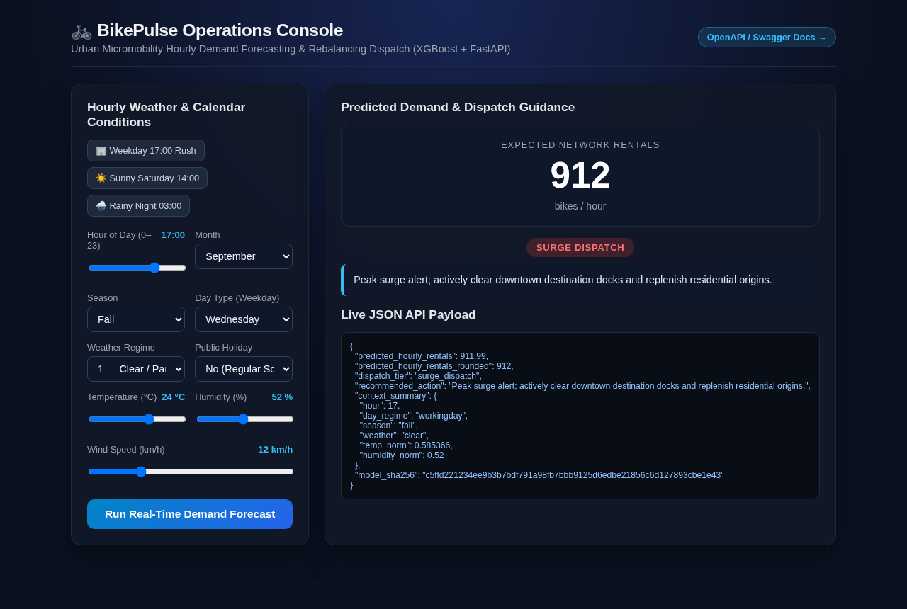
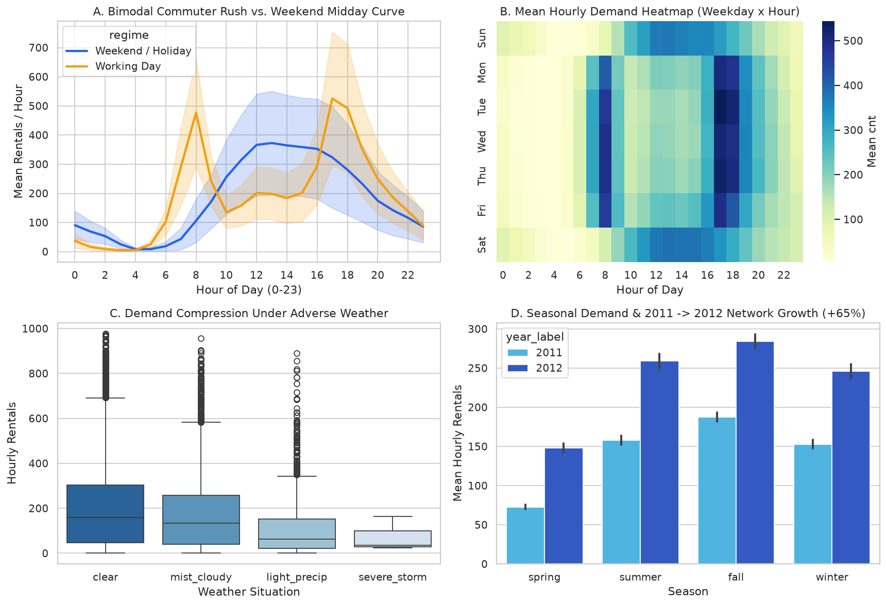
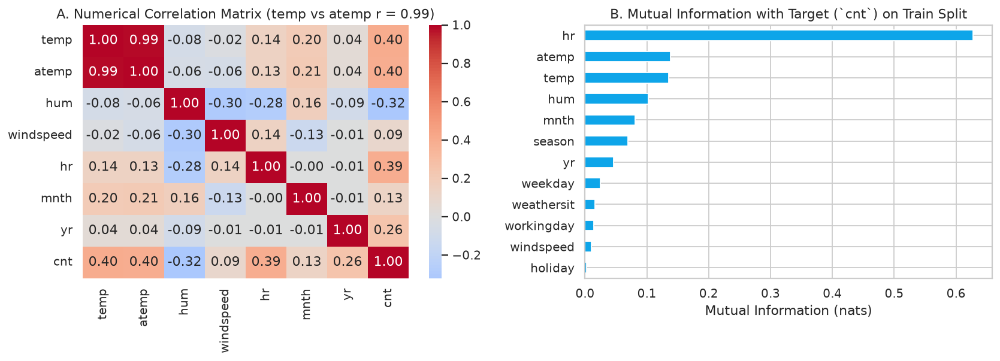
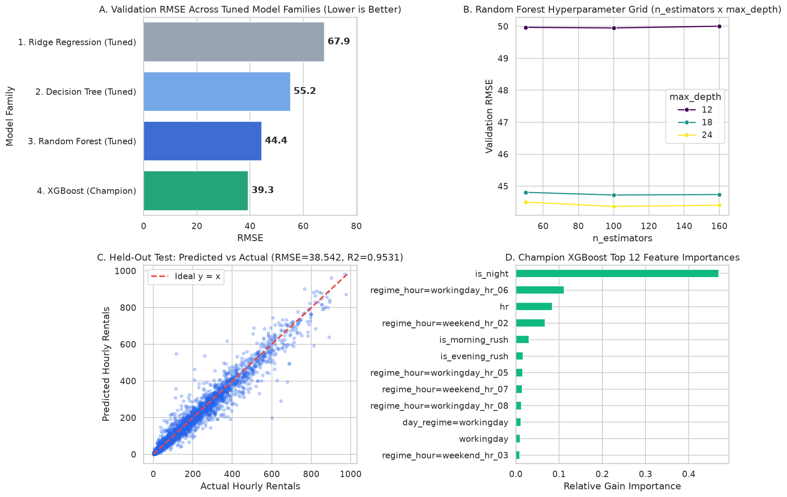
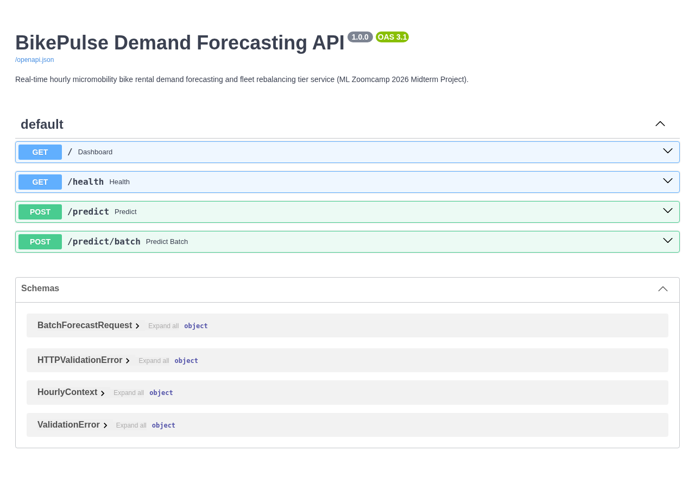

# 🚲 BikePulse: Urban Micromobility Hourly Demand Forecasting & Fleet Rebalancing

**DataTalks.Club Machine Learning Zoomcamp 2026 — Midterm Project**  
* **Author:** Omachoko Yakubu  
* **Repository Path:** [`machine-learning-zoomcamp/midterm-project`](./)  
* **Dataset:** [UCI #275 — Capital Bikeshare Hourly Dataset (`hour.csv`, 17,379 records)](https://archive.ics.uci.edu/dataset/275/bike+sharing+dataset)  
* **CI / Container / Kubernetes E2E Workflow:** [`.github/workflows/midterm-ci.yml`](../.github/workflows/midterm-ci.yml)



---

## 📋 ML Zoomcamp Rubric Compliance Matrix (16 / 16 Points)

| Rubric Criterion | Max Points | Implementation & Verification Evidence |
| :--- | :---: | :--- |
| **1. Problem Description** | **2 / 2** | Detailed operational context, fleet rebalancing workflow, and leakage guards in [Section 1](#1-problem-description--operational-use-case) |
| **2. Exploratory Data Analysis (EDA)** | **2 / 2** | Extensive range/null/anomaly checks (Hurricane Sandy, `hum == 0` sensor faults), target skewness + `log1p`, correlations, and Mutual Information in [`notebook.ipynb`](./notebook.ipynb) |
| **3. Model Training & Tuning** | **3 / 3** | Trained and tuned **4 model families** (linear **Ridge**, **Decision Tree**, **Random Forest**, and **XGBoost**) + 5-fold CV (`RMSE = 38.71`, `$R^2 = 0.9527$`) |
| **4. Exporting Notebook to Script** | **1 / 1** | Modular [`model.py`](./model.py) and standalone CLI [`train.py`](./train.py) exporting checksummed [`artifacts/model.bin`](./artifacts/model.bin) |
| **5. Reproducibility** | **1 / 1** | Committed dataset [`data/bike_sharing_hour.csv`](./data/bike_sharing_hour.csv) + automated SHA-256 downloader [`scripts/download_data.py`](./scripts/download_data.py); deterministic seeds (`42`); executed [`notebook.ipynb`](./notebook.ipynb) |
| **6. Model Deployment** | **1 / 1** | FastAPI service [`predict.py`](./predict.py) serving interactive dashboard (`GET /`), health (`GET /health`), single (`POST /predict`), and horizon (`POST /predict/batch`) endpoints |
| **7. Dependency & Env Management** | **2 / 2** | Locked [`pyproject.toml`](./pyproject.toml) + [`uv.lock`](./uv.lock) + [`requirements.txt`](./requirements.txt) with virtual environment activation instructions in [Section 5](#5-dependency--virtual-environment-setup) |
| **8. Containerization** | **2 / 2** | Production [`Dockerfile`](./Dockerfile) and [`docker-compose.yml`](./docker-compose.yml) with build/run commands in [Section 6](#6-containerization-docker--compose) |
| **9. Cloud & Kubernetes Deployment** | **2 / 2** | Kubernetes manifests in [`k8s/`](./k8s/) (Deployment, Service, HPA), Cloud Run/Render IaC ([`render.yaml`](./render.yaml), [`scripts/deploy_cloud_run.sh`](./scripts/deploy_cloud_run.sh)), automated **Kind Kubernetes cluster E2E CI**, and live service screenshots |

---

## 1. Problem Description & Operational Use Case

Urban bikeshare operators (such as Washington D.C.'s **Capital Bikeshare**) face an asymmetric spatiotemporal balancing problem:
1. **Morning Dock Starvation:** Residential commuter stations empty rapidly between **07:00 and 09:00** on working days, causing lost ridership and subscriber churn.
2. **Downtown Dock Saturation:** Central business district docks fill completely, preventing arriving riders from ending trips and triggering fee credits.
3. **Costly Reactive Dispatch:** Sending rebalancing box-trucks *after* stations hit zero bikes wastes fuel and driver labor compared to proactive pre-positioning 1–24 hours ahead.

### How BikePulse Solves This
**BikePulse** predicts **total hourly network bike rentals (`cnt`)** conditioned on calendar schedule, time of day, season, weather regime, temperature, humidity, and wind speed, then maps each hourly forecast to a **4-tier Fleet Dispatch Action**:

| Forecasted Demand (`cnt`) | Dispatch Tier | Recommended Fleet Operations Action |
| :--- | :--- | :--- |
| `< 75` bikes / hr | `low_demand` | Passive monitoring; schedule overnight depot charging and preventative maintenance |
| `75 – 224` bikes / hr | `normal_operations` | Balanced station turnover; maintain standard van patrol loops |
| `225 – 399` bikes / hr | `rebalance_watch` | Elevated commuter flow; pre-stage rebalancing vans near major metro hubs |
| `>= 400` bikes / hr | `surge_dispatch` | Peak surge alert; actively clear downtown destination docks and replenish residential origins |

---

## 2. Dataset & Leakage Prevention

* **Source:** [UCI Machine Learning Repository #275 — Bike Sharing Dataset](https://archive.ics.uci.edu/dataset/275/bike+sharing+dataset) (*Fanaee-T & Gama, 2013*), combining Capital Bikeshare trip logs (2011–2012) with Freemeteo weather station telemetry.
* **Committed File:** [`data/bike_sharing_hour.csv`](./data/bike_sharing_hour.csv) (`17,379` hourly rows, `17` columns, SHA-256: `e03de4ee4ef4dc376ac6e04bf829673c6269e8eba5c60fa121640fa2f829504f`).
* **Strict Leakage Guard:** Raw records include `casual` and `registered` sub-counts where `casual + registered == cnt` across 100% of rows. Both columns, along with row index `instant` and raw date string `dteday`, are strictly excluded in [`model.py`](./model.py).

---

## 3. Key Insights from Exploratory Data Analysis (`notebook.ipynb`)

All EDA steps and figures are reproducible in [`notebook.ipynb`](./notebook.ipynb):

1. **Right-Skewed Target (`cnt`):** Hourly rentals span `1` to `977` bikes/hr (mean `189.5`, median `142.0`, skewness `1.278`). Training models on $\log(1 + \text{cnt})$ (`np.log1p`) and inverting via `np.expm1` substantially reduces prediction error and guarantees non-negative forecasts.
2. **Sensor Fault & Event Anomalies:**
   * **Zero-Humidity Sensor Fault:** Exactly `22` hours on `2011-03-10` report `hum == 0.0` during light rain (`weathersit == 3`). [`model.py`](./model.py) imputes `hum <= 0` using the training-set median (`0.63`).
   * **Hurricane Sandy Outage:** Out of `17,544` calendar hours in 2011–2012, `165` hours have no trips — most notably `2012-10-29` (only `1` recorded hour) and `2012-10-30` (`11` hours) when Hurricane Sandy shut down Washington D.C.
3. **Bimodal Commuter Interaction:** Linear correlation gives `hr` only $r = 0.39$, whereas **Mutual Information** ranks `hr` #1 (`0.60+` nats) because working days peak sharply at **08:00** and **17:00–18:00** while weekends form a single midday bell curve (**12:00–16:00**).
4. **Collinearity:** Normalized `temp` and feeling temperature `atemp` have $r = 0.988$; tree ensembles and regularized Ridge handle this cleanly alongside engineered `thermal_comfort` and cyclical $\sin/\cos$ hour/month features.





---

## 4. Model Selection, Hyperparameter Tuning & Test Results

Using a deterministic **60% Train (`10,427`) / 20% Validation (`3,476`) / 20% Test (`3,476`)** split (`random_state=42`) and `DictVectorizer` (`134` encoded features), four distinct model families were trained and tuned:

| Model Family | Best Tuned Hyperparameters | Val RMSE ↓ | Val MAE ↓ | Val $R^2$ ↑ |
| :--- | :--- | :---: | :---: | :---: |
| **1. Ridge Regression** | `alpha=0.01`, `target=log1p` | `67.93` | `40.29` | `0.8581` |
| **2. Decision Tree** | `max_depth=20`, `min_samples_leaf=10`, `target=log1p` | `55.17` | `33.68` | `0.9064` |
| **3. Random Forest** | `n_estimators=100`, `max_depth=24`, `min_samples_leaf=2` | `44.37` | `26.73` | `0.9395` |
| **4. XGBoost (Champion)** | `n_estimators=350`, `eta=0.10`, `max_depth=8`, `min_child_weight=3`, `subsample=0.85`, `colsample_bytree=0.85` | **`39.30`** | **`23.69`** | **`0.9525`** |

### Final Champion Generalization (`train.py`)
* **5-Fold Cross-Validation (`full_train`, 80% = 13,903 rows):** `RMSE = 40.61 ± 1.17` (`mean R² = 0.9503`)
* **Held-Out Test Set (`test`, 20% = 3,476 rows):** **`RMSE = 38.71` bikes/hr · `MAE = 22.81` bikes/hr · `$R^2 = 0.9527$`**
* **Exported Artifact:** [`artifacts/model.bin`](./artifacts/model.bin) (`sha256: c5ffd221234ee9b3b7bdf791a98fb7bbb9125d6edbe21856c6d127893cbe1e43`)



---

## 5. Dependency & Virtual Environment Setup

### Option A: Using `uv` (Recommended — Fast & Locked)
```bash
cd midterm-project

# 1. Create .venv and install exact locked dependencies from uv.lock
uv sync --locked

# 2. Activate the virtual environment
source .venv/bin/activate   # On Windows: .venv\Scripts\activate
```

### Option B: Using Standard `venv` + `pip`
```bash
cd midterm-project
python3 -m venv .venv
source .venv/bin/activate
pip install -r requirements.txt
```

### Run Dataset Verification, Model Training, Service & Tests
```bash
# Verify SHA-256 of data/bike_sharing_hour.csv (or download fresh from UCI #275)
python scripts/download_data.py

# Train & tune models and export artifacts/model.bin + metadata
python train.py

# Run automated unit and FastAPI integration test suite
pytest -v

# Start the FastAPI web service and interactive Operations Console on port 9696
uvicorn predict:app --host 0.0.0.0 --port 9696
```

### Test the Live API (`http://127.0.0.1:9696`)
Open **`http://127.0.0.1:9696/`** in a browser for the interactive Operations Console, **`http://127.0.0.1:9696/docs`** for Swagger UI, or query via `curl`:

```bash
curl -s -X POST http://127.0.0.1:9696/predict \
  -H "Content-Type: application/json" \
  -d '{
    "season": 3,
    "yr": 1,
    "mnth": 9,
    "hr": 17,
    "holiday": 0,
    "weekday": 3,
    "workingday": 1,
    "weathersit": 1,
    "temp_celsius": 24.0,
    "humidity_pct": 50.0,
    "windspeed_kmh": 11.0
  }'
```

Sample response:
```json
{
  "predicted_hourly_rentals": 891.95,
  "predicted_hourly_rentals_rounded": 892,
  "dispatch_tier": "surge_dispatch",
  "recommended_action": "Peak surge alert; actively clear downtown destination docks and replenish residential origins.",
  "context_summary": {
    "hour": 17,
    "day_regime": "workingday",
    "season": "fall",
    "weather": "clear",
    "temp_norm": 0.585366,
    "humidity_norm": 0.5
  },
  "model_sha256": "c5ffd221234ee9b3b7bdf791a98fb7bbb9125d6edbe21856c6d127893cbe1e43"
}
```



---

## 6. Containerization (Docker & Compose)

The [`Dockerfile`](./Dockerfile) packages the locked runtime environment (`python:3.12-slim-bookworm` + `uv sync --locked --no-dev`), model artifacts, and FastAPI service with a built-in `HEALTHCHECK`.

```bash
cd midterm-project

# Build the container image
docker build -t bikepulse-api:latest .

# Run the container on port 9696
docker run --rm -p 9696:9696 bikepulse-api:latest

# Or start in the background with Docker Compose
docker compose up --build -d

# Run the end-to-end HTTP smoke test against the running container
python smoke_test.py --url http://127.0.0.1:9696
```

---

## 7. Kubernetes Cluster & Cloud Deployment

### A. Kubernetes Deployment (`k8s/` + Kind / Minikube / EKS / GKE)
Declarative Kubernetes manifests are provided in [`k8s/`](./k8s/) including a 2-replica [`deployment.yaml`](./k8s/deployment.yaml) with readiness/liveness probes, [`service.yaml`](./k8s/service.yaml), and CPU-based [`hpa.yaml`](./k8s/hpa.yaml) (`2–6` pods):

```bash
cd midterm-project

# 1. Build and load image into a local Kind cluster
kind create cluster --name bikepulse-k8s
docker build -t bikepulse-api:ci .
kind load docker-image bikepulse-api:ci --name bikepulse-k8s

# 2. Apply Deployment, Service, and HorizontalPodAutoscaler
kubectl apply -k k8s/
kubectl rollout status deployment/bikepulse-api --timeout=120s

# 3. Port-forward and verify live predictions through Kubernetes Service
kubectl port-forward svc/bikepulse-api 9696:80 &
python smoke_test.py --url http://127.0.0.1:9696
```

> **Automated CI Cluster Verification:** Every push runs [`.github/workflows/midterm-ci.yml`](../.github/workflows/midterm-ci.yml), which builds the Docker image, provisions a live **Kind Kubernetes cluster**, deploys `k8s/`, port-forwards `svc/bikepulse-api`, and validates real `/health`, `/predict`, and `/predict/batch` requests end-to-end.

### B. Serverless Cloud Deployment (Google Cloud Run & Render)
* **Google Cloud Run:** Run [`scripts/deploy_cloud_run.sh`](./scripts/deploy_cloud_run.sh) (`GCP_PROJECT_ID=<your-project> ./scripts/deploy_cloud_run.sh`) to build and deploy as an autoscaling HTTPS microservice and automatically smoke-test the public Cloud Run URL.
* **Render Blueprint:** Connect the repository to Render using [`render.yaml`](./render.yaml) for zero-config Docker web service hosting with `/health` monitoring.

---

## 📂 Project Directory Structure

```text
midterm-project/
├── README.md                        # Problem context, EDA, benchmarks & deployment guide
├── notebook.ipynb                   # Executed EDA, feature importance & 4-family tuning notebook
├── model.py                         # Leakage-free feature engineering & dispatch tier rules
├── train.py                         # Standalone training, 5-fold CV & artifact export CLI
├── predict.py                       # FastAPI web service + interactive Operations Console
├── smoke_test.py                    # End-to-end HTTP verification script
├── pyproject.toml                   # Project metadata & dependencies
├── uv.lock                          # Deterministic cross-platform lockfile
├── requirements.txt                 # Exported pip requirements for standard venv users
├── Dockerfile                       # Production container image definition
├── docker-compose.yml               # Single-command local container stack
├── render.yaml                      # Cloud PaaS deployment blueprint
├── Makefile                         # Developer workflow shortcuts
├── data/
│   └── bike_sharing_hour.csv        # UCI #275 hourly dataset (17,379 rows)
├── artifacts/
│   ├── model.bin                    # Champion DictVectorizer + XGBRegressor bundle
│   ├── model_metadata.json          # Provenance, CV/test metrics & SHA-256 checksums
│   ├── benchmark_results.json       # Validation leaderboard across all 4 model families
│   └── smoke_test_output.json       # Captured live API verification output
├── k8s/                             # Kubernetes Deployment, Service, HPA & Kustomization
├── scripts/                         # Dataset SHA-256 verifier, Cloud Run & screenshot tools
├── static/index.html                # Interactive BikePulse Operations Console UI
├── docs/images/                     # High-DPI EDA/model charts & live UI/Swagger screenshots
└── tests/                           # Pytest unit and FastAPI integration test suite
```
